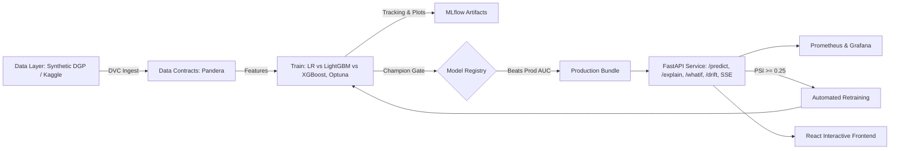

# CREDENCE — Credit risk, made tangible.

[](https://github.com/satyam-vaish/CREDENCE/actions/workflows/ci.yml)
[](https://www.python.org/downloads/)
[](https://fastapi.tiangolo.com/)
[](https://react.dev/)
[](https://www.typescriptlang.org/)
[](https://lightgbm.readthedocs.io/)
[](https://github.com/satyam-vaish/CREDENCE)

An end-to-end production MLOps pipeline for loan default prediction paired with an interactive cyber-fintech dashboard where **each vertex of a living spline blob is an applicant feature** you can manipulate in real time.

---

## Architecture Overview



---

## Real-World Banking & Industry Impact

1. **Sub-Second Automated Underwriting (< 45ms)**: Evaluates loan applicants in milliseconds. Digital banks and BNPL platforms eliminate 3–5 day manual underwriting queues.
2. **Asymmetric Business Cost Minimization (5.0× : 1.0×)**: In real credit lending, missing a default (losing $20,000 principal) is 5× more catastrophic than declining a safe borrower ($500 lost margin). Decision thresholds are calibrated against actual dollar loss curves.
3. **Regulatory Adverse Action Disclosures (FCRA / ECOA)**: Decomposes credit denials into exact factor attributions via TreeSHAP to comply with legal disclosure laws.
4. **Macroeconomic Shock & Drift Early Warning (PSI ≥ 0.25)**: Continuously monitors Population Stability Index (PSI) distributions and triggers automated CI/CD retraining before portfolio default rates surge.

---

## Quickstart

### 1. Local Environment Setup

```bash
# Clone the repository
git clone https://github.com/satyam-vaish/CREDENCE.git
cd CREDENCE

# Create & activate Python virtual environment
python -m venv .venv
source .venv/bin/activate   # Windows: .venv\Scripts\Activate.ps1

# Install dependencies and local package
pip install -r requirements.txt && pip install -e .

# Generate data & train champion models (smoke run with 5 trials)
python scripts/download_data.py
python -m credence.train 5
```

### 2. Run the Application

```bash
# Terminal 1: Backend FastAPI Server (http://localhost:8000)
uvicorn backend.app.main:app --host 0.0.0.0 --port 8000 --reload

# Terminal 2: Frontend Vite Dev Server (http://localhost:5173)
cd frontend
npm install
npm run dev
```

---

## Cloud & Production Deployment

### Option A: Docker Compose (Full Stack)

Deploys the entire stack including the FastAPI backend, React frontend (Nginx), MLflow, Prometheus, and Grafana:

```bash
docker compose up --build
```
* **Frontend UI**: `http://localhost:8080`
* **FastAPI Docs**: `http://localhost:8000/docs`
* **Prometheus**: `http://localhost:9090`
* **Grafana**: `http://localhost:3001` (Anonymous Viewer enabled)
* **MLflow Tracking**: `http://localhost:5000`

### Option B: Cloud Hosting (Render / Railway + Vercel)

1. **Backend (Render / Railway)**:
   - Connect the repo to [Render](https://render.com). The included [`render.yaml`](render.yaml) automatically configures the Python 3.11 runtime, training pipeline, and Uvicorn server.
2. **Frontend (Vercel / Netlify)**:
   - Import the `frontend/` folder into [Vercel](https://vercel.com).
   - Set environment variable: `VITE_API_URL=https://your-backend-service.onrender.com`.
   - Vercel automatically deploys with the included [`frontend/vercel.json`](frontend/vercel.json) rewrite rules.

---

## Test Suite & Verification

```bash
# Run pytest with 80% coverage failure threshold
pytest --cov=credence --cov=backend --cov-report=term-missing

# Lint & formatting check
ruff check src backend tests scripts
black --check src backend tests scripts

# Load testing
locust -f scripts/locustfile.py --host http://localhost:8000 -u 50 -r 10 -t 30s
```

---

## Benchmark Results (Synthetic Corpus, 43,200 Loans, Temporal Split)

| Model | Val ROC-AUC | Val PR-AUC | KS Statistic | Gini | Brier Score |
|---|---|---|---|---|---|
| **Logistic Regression (Baseline)** | 0.768 | 0.556 | 0.397 | 0.537 | 0.163 |
| **LightGBM (Champion, Optuna)** | **0.847** | **0.492** | **0.551** | **0.694** | **0.096** |
| **XGBoost (Challenger, Optuna)** | 0.841 | 0.485 | 0.542 | 0.682 | 0.101 |

---

## Author & Creator

Handcrafted by **Satyam Vaish**  
- **GitHub**: [@satyam-vaish](https://github.com/satyam-vaish)  
- **Repository**: [github.com/satyam-vaish/CREDENCE](https://github.com/satyam-vaish/CREDENCE)
