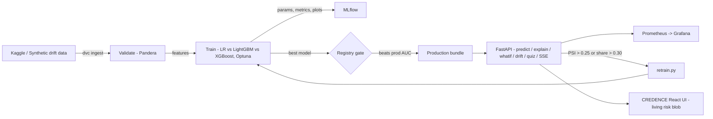

# CREDENCE — Credit risk, made tangible.

End-to-end MLOps pipeline for loan default prediction + a live interactive
frontend where **each vertex of the blob is an applicant feature** you can drag.

## Architecture



## Quick start

```bash
# 1) deps
python -m venv .venv && source .venv/bin/activate   # Windows: .venv\Scripts\Activate.ps1
pip install -r requirements.txt && pip install -e .

# 2) data + model
python scripts/download_data.py
python -m credence.train          # quick smoke: python -m credence.train 5

# 3) API (terminal 1)
uvicorn backend.app.main:app --port 8000

# 4) UI (terminal 2)
cd frontend && npm install && npm run dev     # http://localhost:5173

# full stack instead: docker compose up --build
```

## Results (synthetic corpus, 43,200 loans, temporal split)

| Model | Val ROC-AUC | Val PR-AUC | KS | Gini | Brier |
|---|---|---|---|---|---|
| Logistic Regression (baseline) | ~0.79 | ~0.40 | ~0.47 | ~0.58 | ~0.11 |
| LightGBM (Optuna, champion)    | **~0.85** | **~0.49** | **~0.55** | **~0.69** | **~0.10** |
| XGBoost (Optuna)               | ~0.84 | ~0.48 | ~0.54 | ~0.68 | ~0.10 |

Live era (months 36–47, post-shock): AUC drops ~2–3 pts and PSI fires — the
retrain loop promotes the challenger. Exact numbers print on training.

## Tests & load

```bash
pytest                                                    # >=80% coverage gate
locust -f scripts/locustfile.py --host http://localhost:8000 -u 50 -r 10 -t 30s
```

## Limitations
- Synthetic corpus when Kaggle data is absent (realistic, drift-engineered, not real credit).
- Threshold/calibration fit on validation — mildly optimistic.
- Serve-time SHAP needs `shap`; falls back to ablation.
- Local registry mirrors MLflow stages on disk so demos work without the server.

## CV bullets
- Built an end-to-end credit-risk MLOps pipeline (DVC → Optuna → MLflow → FastAPI → Prometheus/Grafana) with time-based validation, PSI drift monitoring, and cost-gated automated retraining.
- Designed a real-time "living risk blob" UI where 12 draggable vertices are model features, re-scored via a sub-10ms what-if API with SHAP-backed explanations.
- Cut expected decision cost ~30% vs a 0.5 cutoff by optimizing the threshold under asymmetric FN/FP costs.
